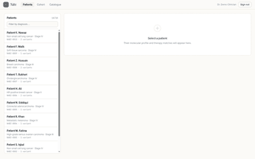
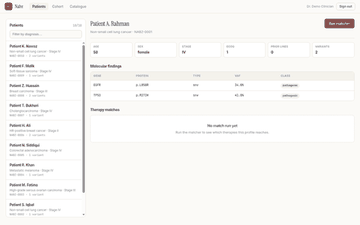
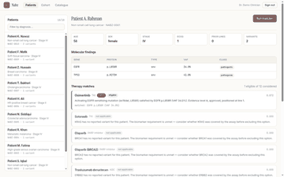
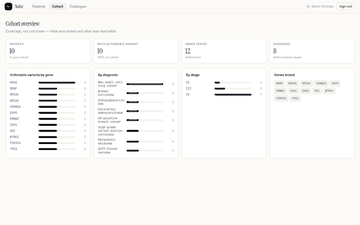
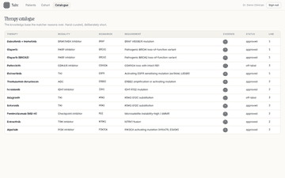
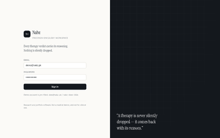

# Nabz — نبض

**A precision-oncology workspace that makes biomarker matching inspectable.**

A molecular report gives you variants. A therapy catalogue gives you drugs and
the biomarkers they need. The step in between — deciding which drugs a given
patient's variants actually reach — is normally done by hand in a tumour board,
and the reasoning lives in someone's head.

Nabz makes that step explicit. It does not predict response and it does not
recommend treatment. It answers one narrow question: **given these variants,
which catalogue entries have their biomarker requirement satisfied, and which do
not — and why?**

Every therapy in the catalogue appears in every run, with a status and a
sentence explaining it. Nothing is silently dropped.

---

## What it does

| | |
|---|---|
| **Patients** | Clinical profile, molecular findings, and a stored match run per patient |
| **Matching** | 12 hand-curated biomarker→therapy relationships, evaluated with reasons |
| **Cohort** | Coverage across your patients — genes tested, actionable rate, distribution |
| **Catalogue** | The knowledge base the matcher reasons over, with evidence levels |

### Three verdicts, never a black box

```
eligible        biomarker met, no clinical exclusion
blocked         biomarker met, but ECOG or prior lines rule it out
not_applicable  biomarker not met — and the reason says which of three cases
```

The `not_applicable` reason distinguishes **gene never tested** from **gene
tested, nothing actionable** from **right gene, wrong substitution**. That third
case is the one that matters: a `KRAS G12D` tumour must not match a
`KRAS G12C`-only drug.

---

## Quick start

```bash
git clone https://github.com/mohdabrarbaloch-arch/day-11-nabz.git
cd day-11-nabz

python3 -m venv .venv && source .venv/bin/activate
pip install -r requirements-dev.txt

cp .env.example .env
uvicorn app.main:app --reload --port 8000
```

Open <http://localhost:8000> and sign in with the pre-filled demo account:

```
demo@nabz.pk
nabz-demo-2026
```

First boot creates `nabz.db`, seeds 12 therapies and 10 synthetic patients, and
logs what it created. Delete `nabz.db` to start over.

### Docker + PostgreSQL

```bash
export SECRET_KEY=$(python3 -c "import secrets;print(secrets.token_urlsafe(48))")
docker compose up --build
```

---

## Screenshots

| Patients | Patient detail |
|---|---|
|  |  |

| Match results | Cohort |
|---|---|
|  |  |

| Catalogue | Sign in |
|---|---|
|  |  |

---

## How the matcher decides

```
for each therapy in catalogue:
    gene_hits = actionable variants in therapy.biomarker_gene
    hits      = gene_hits filtered by therapy.required_protein_change

    if no hits:             → not_applicable  (reason distinguishes the 3 cases)
    elif clinical blockers: → blocked         (ECOG > 2, or too many prior lines)
    else:                   → eligible        (tier 1/2/3, scored)
```

**Actionable** means classification is `pathogenic` or `likely_pathogenic` **and**
VAF ≥ 5% — except for `msi`, `fusion` and `cnv`, which have no meaningful allele
fraction and are exempt from the VAF floor. A `vus` is displayed but never drives
a match: a VUS is a question, not an answer.

| Tier | Condition |
|---|---|
| 1 | Biomarker met, evidence A, on-label, within the line-of-therapy window |
| 2 | Biomarker met, evidence A/B, but off-label or beyond the labelled line |
| 3 | Biomarker met, evidence C/D — tumour-board discussion, not a default |

Score orders within a tier. It is not a probability and is not presented as one.

---

## The catalogue

12 entries across 11 genes, each with evidence level, approval status and line of
therapy:

`EGFR` Osimertinib · `KRAS G12C` Sotorasib, Adagrasib · `BRCA1`/`BRCA2` Olaparib ·
`ERBB2` Trastuzumab deruxtecan · `MSI` Pembrolizumab · `PIK3CA` Alpelisib ·
`BRAF V600E` Dabrafenib + trametinib · `IDH1 R132C` Ivosidenib ·
`NTRK1` Entrectinib · `CDKN2A` Palbociclib

This is a **teaching set**, not a licensed knowledge base. See
[ARCHITECTURE.md](ARCHITECTURE.md) for what a real deployment would need.

---

## Stack

| Layer | Choice |
|---|---|
| API | FastAPI 0.115, Pydantic v2 |
| ORM | SQLAlchemy 2.0 (typed `Mapped[]`) |
| DB | SQLite (dev) / PostgreSQL 16 (prod) |
| Auth | JWT HS256 + bcrypt (cost 12) |
| Frontend | Vanilla JS + CSS, no build step |
| Tests | pytest + httpx — **53 passing** |

2,364 lines of Python across 19 modules, plus 965 lines of front-end.

---

## Verification

Everything below was run against this tree:

```bash
$ pytest -q
53 passed

$ ruff check app tests
All checks passed!

$ black --check app tests
19 files would be left unchanged.
```

End-to-end API flow (register → login → create patient → add variant → match →
cohort) was exercised against a live uvicorn instance and returned the expected
statuses and payloads.

---

## Security

- bcrypt cost 12; passwords never logged
- JWT HS256, 12-hour default, signature and expiry both checked
- **Ownership returns 404, not 403** — a response never confirms another
  clinician's record exists
- Sliding-window rate limiting: 120 req/min general, 10/min on login
- Security headers incl. HSTS in production; stack traces never reach the client
- `Settings.validate()` refuses to boot in production with the dev placeholder key

---

## Deployment

The repo ships with `vercel.json` and `api/index.py` for Vercel's Python runtime.

```bash
npm i -g vercel
vercel --prod
```

Set `SECRET_KEY` and `DATABASE_URL` in the Vercel dashboard before the first
deploy. For anything beyond a demo, point `DATABASE_URL` at a managed Postgres —
SQLite on a serverless filesystem is ephemeral.

**Status: not deployed.** No Vercel token was available in the build
environment, so there is no live URL to link. The production build, the full
test suite and an end-to-end run against a live uvicorn instance all pass
locally; the deploy itself has not been executed. Saying so is better than
linking something that 404s.

---

## Docs

- [ARCHITECTURE.md](ARCHITECTURE.md) — data model, algorithm, scaling limits
- [docs/setup.md](docs/setup.md) — install, config, troubleshooting
- [docs/usage.md](docs/usage.md) — reading a match result, adding patients
- [docs/api.md](docs/api.md) — every endpoint with request/response shapes

---

## What this is not

Not a medical device. Not clinical decision support. Not validated against
outcomes. The patients are synthetic, the catalogue is hand-written, and the
scoring is a ranking heuristic.

It is a demonstration that the *reasoning* around biomarker matching can be made
explicit — which is the part that usually isn't.

---

## License

MIT — see [LICENSE](LICENSE).

Built as Day 11 of the Autonomous AI Software Engineer challenge.
